<p align="center">
  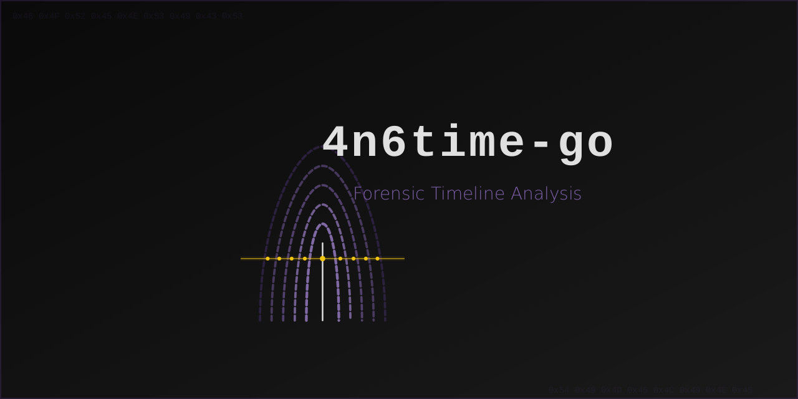
</p>

# 4n6time-go

Forensic timeline analysis tool, rewritten from Python to Go. Desktop application for analyzing large-scale forensic datasets, particularly timeline data from log2timeline (L2T) format files.

## Features

- Import L2T CSV, Plaso JSONL, TLN, L2TTLN, dynamic CSV, **EZ Tools CSV**, and **macOS Unified Log** (CSV and JSONL) files, and **mac_apt** (CSV and JSONL) files (tested with 2GB+ files, millions of events)
- **EZ Tools CSV import**: auto-detect and import output from Eric Zimmerman's tools with multi-timestamp expansion (EvtxECmd, PECmd, LECmd, JLECmd, SBECmd, MFTECmd, AmcacheParser, SrumECmd, RBCmd, WxTCmd, AppCompatCacheParser; 28 subtypes total)
- **macOS Unified Log import**: CSV and JSONL output from Mandiant's macos-UnifiedLogs `unifiedlog_iterator`
- **mac_apt import**: CSV and JSONL output from ydkhatri's mac_apt (tested with v1.36.2), including Spotlight store files
- **Import Folder (Recursive)**: walk a collection folder up to 3 levels deep and import every supported EZ Tools, Unified Log, and mac_apt file, with a summary grouped by tool family, duplicate exports skipped, and unparseable timestamp counts shown
- **Tab system**: right-click any event to open a filtered view in a new tab; each tab has independent filters, search, and pagination; tab sessions persist per-database and are restored on next open
- **SQLite and PostgreSQL** database backends (SQLite for local work, PostgreSQL for team/server deployments)
- **Examiner notes**: add timestamped investigation notes directly into the timeline grid alongside evidence events
- **Advanced search**: toggle between keyword search and SQL WHERE clause mode with full query syntax
- **Bulk select and edit**: shift-click or ctrl-click to select multiple rows, then apply color, tags, or bookmarks to all at once
- **Multi-import**: import additional timeline files into an already-open database to combine evidence sources
- **Import provenance**: every import is recorded with an optional label (for example, a hostname). Each event shows its import in the detail panel, can be filtered or pivoted by import, and exports with an `import_file` column
- **Imports list** (File > Imports...): every import record in the open database, with its label, file, status, event count, import time, and error text; failed imports are highlighted
- **Import failure dialog**: a failed import shows the file, the error, and what was left in the database, with a button to the Imports list
- **Clear open errors**: a database on read-only storage that needs a one-time upgrade gets a dialog explaining how to open a copy, and any other file that cannot be opened gets a dialog with a plain explanation, the error, and which database is still open. The current database stays open when another fails to open
- **Recount Events** (Tools > Recount Events): recounts the events and corrects the stored total if it ever looks wrong
- **PostgreSQL connect timeout and Cancel**: a connection attempt gives up after 10 seconds with a plain message, Cancel stops an attempt in progress, and Reset restores the connection dialog's fields
- **Large databases**: the event total is cached, the filter panel loads its values without scanning every event, Clear Filters is fast, superseded page loads are cancelled on the server, and bulk color and tag edits update the rows in place
- **Settings** (Tools > Settings): configure tab limit, auto-restore, and default PostgreSQL hostname
- Server-side pagination with First, Last, Go-to-page, and "Page X of Y" controls
- Full-text search across all key event fields with keyword highlighting
- Filter panel with AND/OR logic, date range, and multi-field filters
- Timeline histogram with click-to-filter and drag-to-select range, plus an examiner notes lane below the bars
- Resizable event detail panel with editable tags, colors, and notes
- Bookmark events with star toggle (filter to show bookmarked only)
- Color-coded rows for marking events of interest
- Push SQLite data to a PostgreSQL server for sharing with a team
- Saved queries (stored in the database file)
- Column visibility toggle (show/hide any of the 24+ columns)
- Export filtered results to CSV (in advanced search mode, the export matches the grid exactly)
- 11 UI themes (Forensic Dark, Classic Dark, High Contrast, Light, Solarized, Monokai, Dracula, Nord, Gruvbox, Matrix, Forensic Blue)
- Built-in logging system for troubleshooting (Help > Logging)
- Built-in user guide (no internet required)
- Native desktop menus with keyboard shortcuts
- Multi-platform builds via GitHub Actions (Linux, Windows, macOS)

## Screenshots

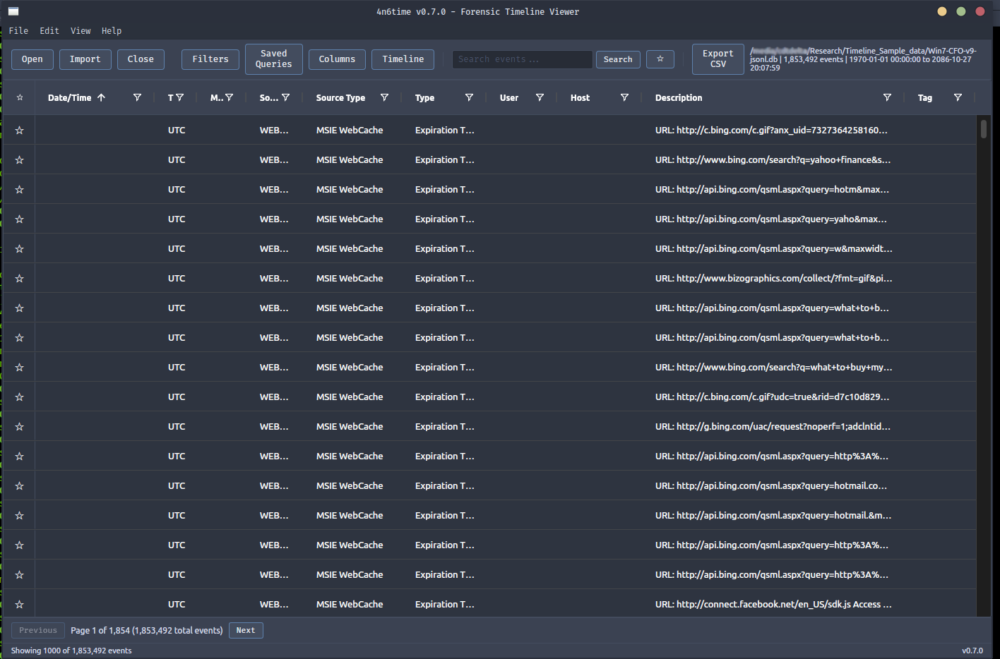

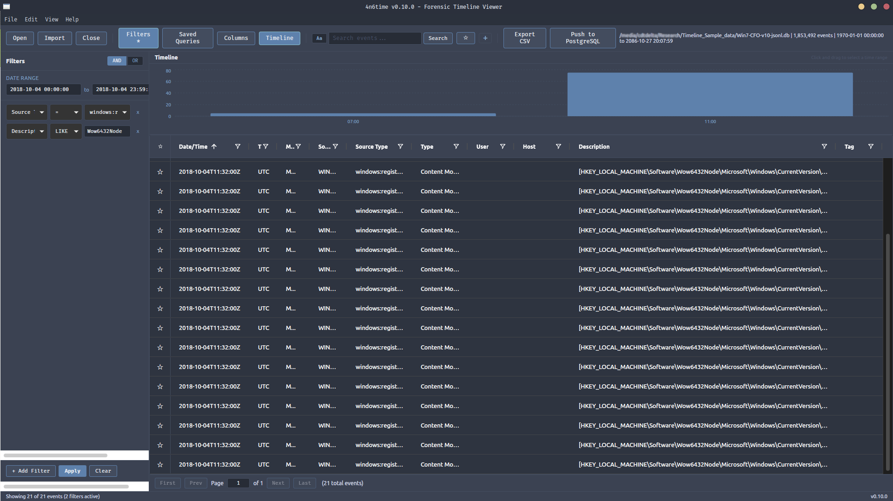

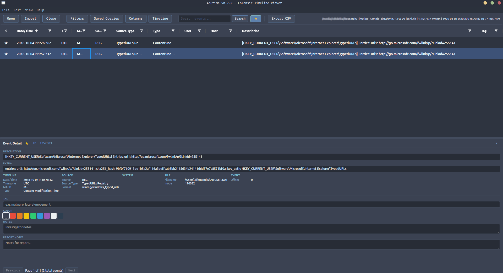

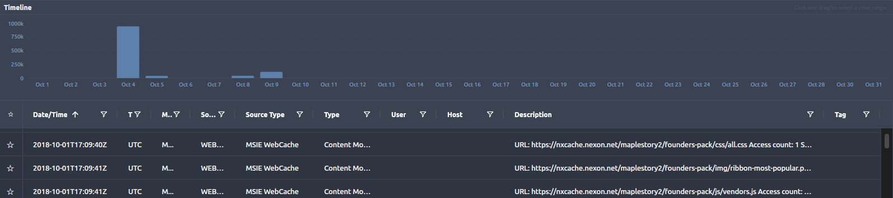

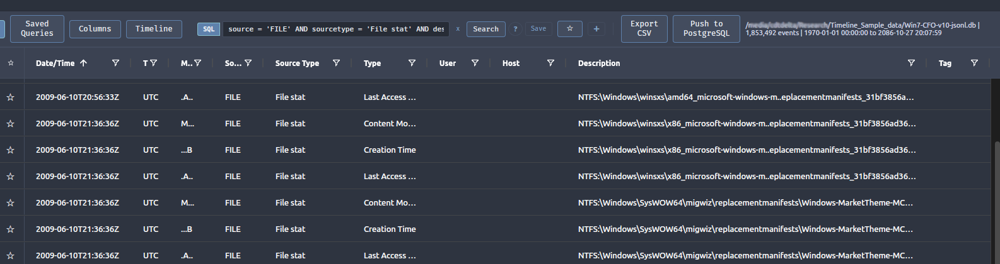

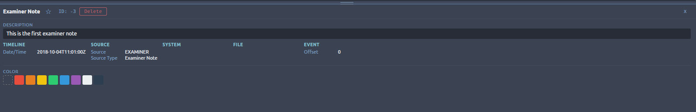

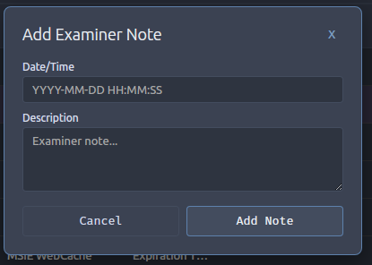

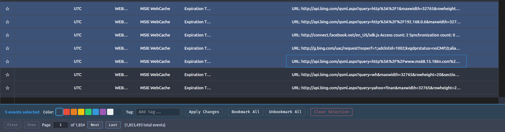

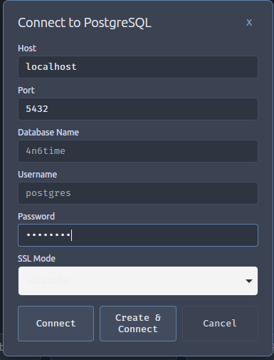


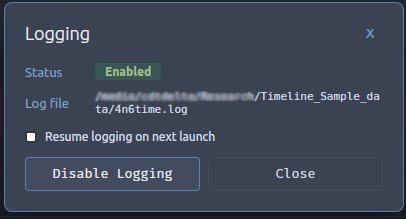

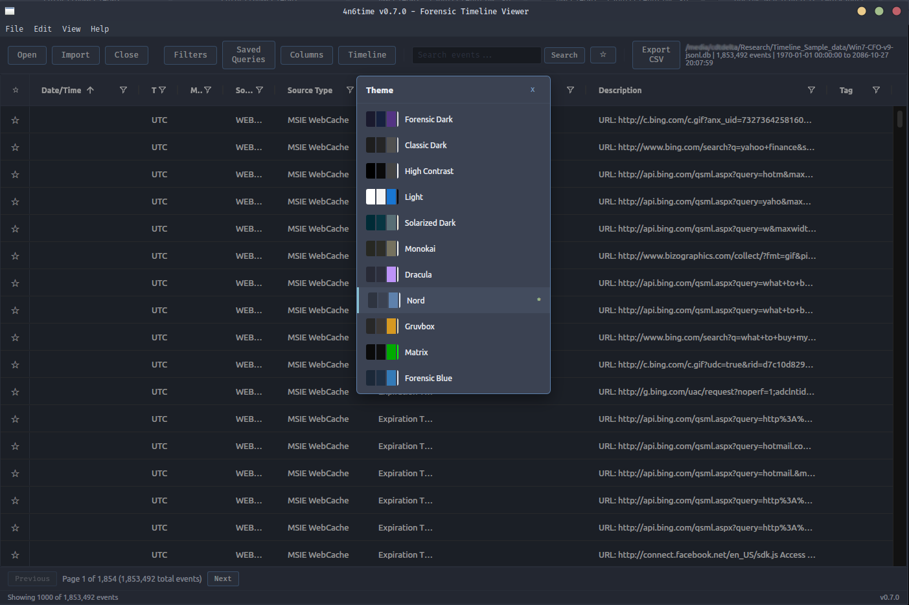

## Tech Stack

- **Backend:** Go, SQLite (modernc.org/sqlite, pure Go), PostgreSQL (pgx)
- **Frontend:** React, AG Grid, Recharts
- **Framework:** Wails v2 (native desktop, no Electron)

## Building

### Prerequisites

- Go 1.26+
- Node.js 22 LTS
- Wails CLI: `go install github.com/wailsapp/wails/v2/cmd/wails@latest`
- Linux: `libgtk-3-dev libwebkit2gtk-4.1-dev pkg-config`
- Windows: WebView2 runtime (included in Windows 10/11)
- macOS: No additional dependencies

### Build

```bash
cd frontend && npm install && npm run build && cd ..
wails build -tags webkit2_41   # Linux
wails build                     # Windows / macOS
```

The binary is output to `build/bin/`.

### Development (Docker)

```bash
docker compose up -d
docker compose exec dev bash
cd /workspace/frontend && npm run build
cd /workspace && wails build -tags webkit2_41
```

Run the binary on the host: `~/source/4n6time-go/build/bin/4n6time`

Tests: `go test ./...` includes the notes matrix (about a minute on SQLite); set `TEST_PG_DSN` to also run it against PostgreSQL; `go test -short ./...` skips the generated cases.

## Usage

1. Launch the application
2. Click **Import Timeline** to import a timeline file (L2T CSV, JSONL, TLN, L2TTLN, dynamic CSV, EZ Tools CSV, Unified Log CSV/JSONL, or mac_apt CSV/JSONL), or **Open** to load an existing database
3. Use the **Filters** panel to narrow results by source, host, type, user, or date range
4. Click **Timeline** to visualize event distribution over time
5. Click any row to view full event details and add tags/notes/colors
6. Use **Saved Queries** to store and recall frequently used filter sets
7. Use **Columns** to show or hide fields in the grid
8. Use **Export CSV** to save filtered results
9. Change the UI theme via **View > Theme** (Ctrl+T)

### Tab System

Right-click any row in the event grid to open a context menu with "Search in new tab" options for key fields (host, user, source, filename, and more). Each tab maintains its own independent filters, search, and pagination; the original tab is unchanged.

- Tabs can be saved to the Saved Queries list using the save icon on the tab; loading a saved tab query reopens it in a new tab
- When data is modified in one tab (color change, bookmark, etc.), other tabs show a stale indicator dot and can be refreshed with the refresh button
- Tab sessions are saved when you close the database or application; on next open you are prompted to restore them (or they restore automatically if auto-restore is enabled)
- Configure the tab limit (default 5) and auto-restore behavior via **Tools > Settings**

### Examiner Notes

Add timestamped investigation notes directly into the timeline alongside evidence events. Click the **+** button in the toolbar to open the Add Note dialog and enter a date/time and a description. The date/time is UTC, typed as `YYYY-MM-DD HH:MM:SS` or pasted from the grid (`2009-07-14T04:58:36Z`); time zone offsets, fractional seconds, and date-only input are rejected. Notes appear in the grid with source "EXAMINER" and sourcetype "Examiner Note", and in a lane below the timeline histogram bars. They filter exactly like timeline events, in simple and advanced search, and can be color-coded and bookmarked. Notes are immutable after creation; to change one, delete it from the detail panel and re-enter it.

### Advanced Search

Toggle between simple keyword search and SQL WHERE clause mode using the **Aa/SQL** button next to the search bar. In SQL mode, enter any valid WHERE clause using field names and SQL operators:

```
source = 'FILE'
desc LIKE '%malware%' AND host = 'WORKSTATION1'
datetime BETWEEN '2025-01-01' AND '2025-06-01'
```

Click the **?** button to see all available field names and operators. Advanced queries can be saved and loaded from the Saved Queries panel. On PostgreSQL, the reserved words `desc`, `user`, and `offset` are auto-quoted.

Semicolons and SQL comments (`--`, `/*`) are not permitted in an advanced search clause and are rejected with an error before the query runs. They are allowed inside quoted string values (for example `desc LIKE '%a;b%'`). Export CSV in advanced mode exports exactly the rows shown in the grid.

### Bulk Editing

Select multiple rows using shift-click (range) or ctrl/cmd-click (individual toggle). When multiple rows are selected, a bulk action bar appears with color swatches, a tag input, bookmark buttons, and an "Apply Changes" button. Select a color and/or enter a tag, then click Apply Changes to update all selected events at once. Examiner note tags are protected from bulk tag changes.

### Multi-Import

When a SQLite or PostgreSQL database is already open, importing a timeline file appends the data to the existing database instead of creating a new one. This lets you combine multiple evidence sources (e.g., multiple hard drive images) into a single investigation database.

**Multi-host cases:** label each import with the hostname it came from when you import it. Then filter by Import, or right-click an event and choose its Import entry, to review one host at a time. The label and file name are recorded when the import runs and cannot be edited afterward.

### EZ Tools Import

4n6time can import CSV output from Eric Zimmerman's forensic artifact parsers, auto-detecting the tool from column headers and expanding multiple timestamp columns into individual timeline events with appropriate MACB notation.

**Single file:** Use the **Import Timeline** button or File > Import Timeline. EZ Tool CSVs are auto-detected alongside other supported formats.

**Folder:** Use **Import Folder (Recursive)** (see below) to import a whole tool output or KAPE collection folder.

Supported tools: **EvtxECmd** (Windows Event Logs), **PECmd** (Prefetch), **LECmd** (LNK files), **JLECmd** (Jump Lists), **SBECmd** (ShellBags), **MFTECmd** ($MFT, $J; $Boot and $SDS recognized but skipped), **AmcacheParser** (AssociatedFileEntries, UnassociatedFileEntries, ProgramEntries, DeviceContainers, DevicePnps, DriveBinaries, DriverPackages, ShortCuts), **SrumECmd** (AppResourceUseInfo, AppTimeline, EnergyUsage, NetworkConnections, NetworkUsages, PushNotifications, vfuprov), **RBCmd** (Recycle Bin), **WxTCmd** (Activity; PackageIDs recognized but skipped), **AppCompatCacheParser** (ShimCache).

### Import Folder (Recursive)

Use the **Import Folder (Recursive)** button on the welcome screen or File > Import Folder (Recursive) to import every supported file in a folder tree at once.

- Walks the selected folder up to 3 levels deep (the selected folder is depth 0). Symlinks are skipped.
- Imports EZ Tools CSV files, macOS Unified Log CSV and JSONL files, and mac_apt CSV and JSONL files. Other formats, such as L2T CSV and Plaso JSONL, are imported one file at a time with **Import Timeline**.
- The post-import summary groups per-tool file and event counts by tool family (EZ Tools, UnifiedLog, mac_apt) with a subtotal per family. A tool's or family's event count shows an "(N unparseable)" suffix when timestamp values were skipped, and a collapsible table lists each file with skipped values.
- A collapsible skipped-files list shows every file that was not imported and why: unrecognized format, empty file, parse error, recognized but no timestamp columns (MFTECmd $Boot and $SDS, WxTCmd PackageIDs, mac_apt Network_Details, Network_Interfaces, and FileSharing), or duplicate.
- **Duplicate Unified Log exports** are imported once. A CSV and a JSONL with the same base name in one directory are duplicates, as are files whose first record matches on boot UUID, millisecond timestamp, and process UUID. The JSONL file is kept. A shared boot UUID alone does not count, since separate collections from the same boot share it.
- **Duplicate mac_apt exports** are imported once. A CSV and a JSONL with the same base name in one directory that detect as the same output are duplicates. The JSONL file is kept, and the CSV is listed as "duplicate of <file> (same mac_apt data)".

### macOS Unified Log Import

4n6time imports the output of `unifiedlog_iterator` from Mandiant's [macos-UnifiedLogs](https://github.com/mandiant/macos-UnifiedLogs) project (tested with v0.7.0). Both output formats are supported and auto-detected:

- **JSONL** (preferred): one JSON object per line. It is a superset of the CSV, adding message flags and the evidence path.
- **CSV**: the iterator's CSV output, including messages that span multiple lines. Output from older versions without the `Parent Activity ID` column also imports.

Field mapping:

| 4n6time field | Unified Log value |
|---|---|
| source / sourcetype | `UNIFIEDLOG` / `macOS Unified Log` |
| type | Event Type (Log, Activity, Signpost, Simpledump, Statedump, Loss) |
| event_type | Log Type (Default, Info, Debug, Error, Fault, and so on) |
| desc | Message, or Raw Message when Message is empty |
| filename | Process |
| source_name | Subsystem (blank when empty) |
| user | EUID |
| extra | full-precision timestamp, category, pid, thread_id, library, UUIDs, activity IDs, timezone, raw message; JSONL adds message flags and evidence |

The datetime column is second precision, like every other format. The full-precision source timestamp is the first entry in the extra column, for sub-second ordering. The evidence path is trimmed to the part inside the `.logarchive` bundle (for example `Persist/0000000000000078.tracev3`), since the rest of the path describes the analysis machine rather than the evidence.

### mac_apt Import

4n6time imports the CSV and JSONL output of ydkhatri's [mac_apt](https://github.com/ydkhatri/mac_apt) (tested with v1.36.2). Choose CSV or JSONL output when you run mac_apt. SQLite (.db), TSV, and XLSX output are not supported.

**Supported outputs:** browser and download data (Safari, Cookies, CFURL cache, quarantine records), system history (install history, XProtect behavior, Utmpx, terminal sessions, sudo last run), privacy permissions (TCC), user and account data (Users, internet accounts, Dock items, recent items), Spotlight (shortcuts, store metadata), network leases (DHCP), FsEvents, Biome, and the ASL system log. Each row's timestamps become timeline events, and each timestamp column makes its own event.

**Single file:** use **Import Timeline**. The output is detected from the file's column headers (CSV) or keys (JSONL). CSV and JSONL output of the same mac_apt output import identical events. This holds for every output except Spotlight stores, which are CSV only.

**Folder:** use **Import Folder (Recursive)**. A CSV and JSONL pair of one output imports once, keeping the JSONL. Outputs with no timestamps (Network_Details, Network_Interfaces, FileSharing) are listed as skipped with the reason "no timestamp columns".

**Spotlight store files** (named `Spotlight-<store>.csv`) are CSV only. Their timestamp columns vary by store, so each file's columns decide which values become events. Expiration dates are never timeline events.

**FsEvents times are approximate.** mac_apt's FsEvents output records the modification time of the fseventsd log file that held the events, not the time of each event. The event type says so.

**Unparseable timestamps:** if a timestamp value cannot be read, the row still imports, but that value makes no event. A notice reports how many values were skipped. Logging records up to 10 examples per file, as `row <n>, column <name>: "<value>"`, where row 1 is the header row of the CSV. To get the examples, turn on logging under Help > Logging and import the file again.

### PostgreSQL Support

4n6time can connect to a PostgreSQL server as an alternative to local SQLite databases:

1. Click **PostgreSQL** on the welcome screen to open the connection dialog
2. Enter connection details: host, port, database name, username, password, and SSL mode
3. Click **Connect** to connect to an existing database, or **Create & Connect** to create the schema on an empty database
   - An attempt gives up after 10 seconds if the server does not answer, and **Cancel** stops an attempt in progress. A failure is explained in the dialog, with the raw error beneath, so you can fix the settings and try again
   - **Reset** (under SSL Mode) restores every field to its starting value. The password is cleared whenever the dialog closes
4. When connected to PostgreSQL, importing a timeline file writes directly to the server (no local file needed)
5. To push an existing SQLite database to PostgreSQL, open the SQLite database first, then click the **Push to PostgreSQL** button in the toolbar

### Large cases on PostgreSQL

These server settings are starting points for cases with tens of millions of events, not requirements. Measure on your own server and adjust.

- **WAL and checkpoints for bulk imports.** A large import writes a lot of WAL; a bigger `max_wal_size` and a longer `checkpoint_timeout` mean fewer forced checkpoints during the import. As a superuser:

  ```sql
  ALTER SYSTEM SET max_wal_size = '8GB';          -- 8GB or more for bulk imports
  ALTER SYSTEM SET checkpoint_timeout = '15min';
  SELECT pg_reload_conf();
  ```

- **Vacuum and analyze after large imports,** so the planner has current statistics and the visibility map is up to date:

  ```sql
  VACUUM (ANALYZE) log2timeline;
  ```

- **PostgreSQL in Docker: raise `shm_size`.** Docker's 64MB default shared memory can make parallel queries and vacuum fail. For example, in `docker-compose.yml`:

  ```yaml
  services:
    postgres:
      shm_size: 1gb
  ```

- **Finding slow queries.** Log every statement slower than a threshold, then look in the server log:

  ```sql
  ALTER SYSTEM SET log_min_duration_statement = '2s';
  SELECT pg_reload_conf();
  ```

  Set it back with `ALTER SYSTEM RESET log_min_duration_statement;` and reload when you are done.

- **A wrong port can look like a hang.** A firewall that silently drops packets to closed ports gives no answer at all, so a mistyped port looks like a stalled connection. 4n6time gives up after 10 seconds and says the server could not be reached; check the host and port first. The `PGCONNECT_TIMEOUT` environment variable (in seconds) overrides the 10-second limit.

## Acknowledgments

Special thanks to David Nides for creating the original 4n6time application, which served as the inspiration for this project.

## License

MIT License. See [LICENSE](LICENSE) for details.
